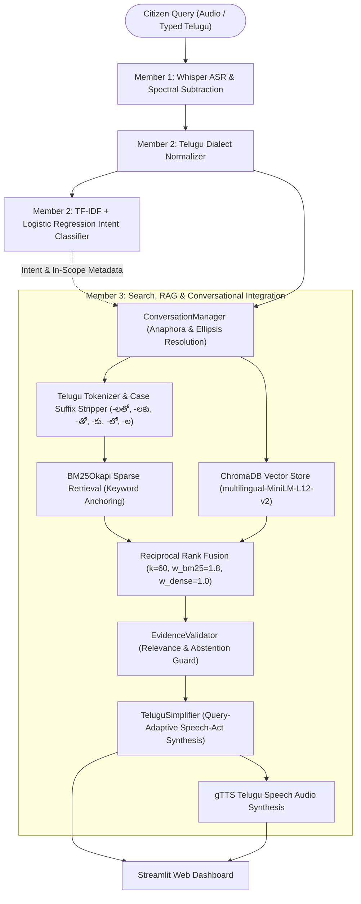

# 🏛️ Member 3 System Architecture & Technical Specifications

**Student Name / Roll Number:** Member 3 (`S20240030382`)  
**Project:** Dialect and Noise-Robust Telugu Civic Assistant  
**Role:** Search, RAG & UI Integration Lead  
**Component Scope:** Suffix-Stripped Hybrid RAG (BM25 + ChromaDB RRF), Evidence Validation, Grounded Answer Generation, Multi-Turn Dialogue Management, and Streamlit Dashboard.

---

## 1. High-Level System Architecture

The Telugu Civic Assistant connects speech processing, dialect normalization, intent recognition, hybrid information retrieval, and conversational answer synthesis into an end-to-end pipeline:

---

## 2. Core Modules Owned by Member 3

### A. Suffix-Stripped Hybrid Retriever (`src/hybrid_retriever.py`)
Standard IR fails on agglutinative Indic languages because nominal postpositions and case markers attach directly to nouns:
$$\text{రైతు (farmer)} \quad\longleftrightarrow\quad \text{రైతుకు (to farmer)} \quad\longleftrightarrow\quad \text{రైతుతో (with farmer)}$$

1. **Telugu Tokenizer & Suffix Stripper:**
   - Strips 10 nominal case suffixes (`-లతో`, `-లకు`, `-లోని`, `-లారా`, `-తో`, `-కు`, `-కి`, `-లో`, `-ను`, `-ని`, `-లు`, `-ల`) when stem length $\ge 3$.
   - Strips Telugu Unicode zero-width non-joiners (`ZWNJ`, `\u200c`) and joiners (`ZWJ`, `\u200d`) with Unicode NFC enforcement.
2. **Sparse Lexical Engine:**
   - `rank_bm25.BM25Okapi` indexing 20 official civic policy chunks across 4 flagship welfare schemes.
3. **Dense Semantic Engine:**
   - `sentence-transformers/paraphrase-multilingual-MiniLM-L12-v2` generating 384-dimensional dense vectors indexed in `chromadb`.
4. **Reciprocal Rank Fusion (RRF):**
   - Combines sparse and dense candidate lists using the official RRF formulation ($k=60$):
     $$\text{RRF\_Score}(d) = \frac{1.8}{60 + \text{Rank}_{\text{BM25}}(d)} + \frac{1.0}{60 + \text{Rank}_{\text{Dense}}(d)}$$
   - Suffix stripping boosts MRR from **0.7997 to 0.8069**, and Hybrid RRF achieves **Recall@3 of 92.86%**.

---

### B. Dialogue & State Management (`src/conversation_manager.py`)
Civic users frequently ask elliptical or deictic follow-ups without repeating the scheme name:
- *Turn 1:* `"రైతు బంధు పథకానికి ఎవరు అర్హులు?"` $\rightarrow$ System registers active scheme: `rb`.
- *Turn 2 (Elliptical):* `"ఏమేం కాగితాలు కావాలి?"` $\rightarrow$ System resolves to: `"రైతు బంధు ఏమేం కాగితాలు కావాలి?"`.
- *Turn 3 (Anaphoric):* `"దానికి ఎంత ఇస్తారు?"` $\rightarrow$ System resolves `"దానికి"` $\rightarrow$ `"రైతు బంధు పథకానికి ఎంత ఇస్తారు?"`.
- *Context Switching:* If the user suddenly asks `"ఆరోగ్యశ్రీ కార్డు ఎలా పొందాలి?"`, the system detects `as` keywords and seamlessly switches the active scheme state.
- *Ambiguity Guard:* If an anaphoric query is asked with no active session history, the system conservatively flags `status = "AMBIGUOUS"`.

---

### C. Evidence Validation & Safe Abstention (`src/answer_validator.py`)
To prevent LLM hallucination and ensure 100% adherence to verified government orders:
1. **RRF Threshold Check:** Candidate chunks must exceed minimum score ($0.016$).
2. **Lexical Overlap & Out-of-Domain Guard:** Rejects trick queries (e.g. cricket scores, gold rates, bus timings) that lack civic terminology.
3. **Sub-Category Passage Alignment:** Aligns retrieved passages to specific sub-topics (`HELPLINE_AND_FAQS`, `REQUIRED_DOCUMENTS`, `BENEFITS`, `APPLICATION_PROCEDURE`, `ELIGIBILITY`).
4. **Currency & Abbreviation Protection:** Uses negative lookbehind regex `(?<!రూ)(?<!నెం)(?<!నం)(?<!డా)(?<!\d)\.(?:\s+|\n+|$)` so sentence splitting never fragments currency amounts (e.g. `రూ. 5 లక్షలు`) or portal URLs (`apagrisnet.gov.in`).

---

### D. Query-Adaptive Conversational Synthesis (`src/simplifier.py`)
Instead of dumping static, verbatim policy text, the generator classifies the user's speech act and synthesizes grounded answers:
- **Polar Verification (Yes/No):** Prefaces answers with `❌ **లేదు, అధికారిక నిబంధనల ప్రకారం...**` or `✅ **అవును, అధికారిక సమాచారం ప్రకారం...**` followed by related rules.
- **Financial Benefits:** Structures answers with `💰 **... పథకం కింద ఆర్థిక సహాయం & ప్రయోజనాలు:**`.
- **Required Documents:** Structures answers with `📑 **... దరఖాస్తుకు అవసరమైన అధికారిక పత్రాలు (Required Documents):**`.
- **Helplines & Inquiries:** Structures answers with `📞 **... అధికారిక టోల్-ఫ్రీ హెల్ప్‌లైన్ & సంప్రదింపుల వివరాలు:**`.
- **Safe Guided Fallback:** If a query mentions an official scheme but specific details are not in the KB text, routes the citizen directly to verified 24x7 state helplines (`1907`, `104`, `1902`, `1800-200-1001`).

---

### E. Streamlit Web Dashboard (`app.py`)
- **Multi-Turn Chat Assistant:** Interactive conversational interface with chat history, follow-up bubbles, and audio playback.
- **Dual-Mode Query Input:** Keyboard Telugu typing + Transliteration helper + Audio `.wav` upload.
- **Pipeline Diagnostics Expander:** Inspects normalized text, intent label & confidence, top retrieved passages, BM25/Dense ranks, and RRF score.
- **Audio Waveform Visualizer:** Displays side-by-side waveforms of noisy traffic speech vs cleaned denoised audio.
- **Offline Demo Cache:** Serves verified Q&A pairs instantly if network connectivity drops during presentations.

---

### F. Verified Scheme-Alias Router & Civic Language Guardrail (`src/transliterate.py`)
Handling Latin-alphabet (Tanglish) input in high-stakes civic welfare AI requires strict safety guarantees:
1. **Core Supported Modalities:** Native Telugu Unicode script and Telugu Voice Input (Member 1 ASR/spectral subtraction).
2. **Technical Constraints with Open-Vocabulary Transliteration:**
   - **IndicXlit (ai4bharat):** Relies on `fairseq`, which fails compilation on Windows with Python 3.12.
   - **Rule-Based Sanscript (ITRANS):** Distorts colloquial colloquialisms (e.g. `arogya sri eppudu vastundi` $\rightarrow$ `అరోగ్య స్రి ఏప్పుదు వస్తుంది`), corrupting vowel lengths and sibilants, causing BM25 retrieval to fail completely.
3. **Verified Entity & Intent Routing:**
   - For Latin queries matching canonical scheme aliases (`rythu bandhu`, `aarogyasri`, `amma vodi`, `asara pension`) and recognized intent concepts (`eligibility`, `documents`, `benefits`, `apply`, `helpline`), the engine deterministically resolves to official canonical Telugu queries (`"రైతు బంధు పథకానికి ఎవరు అర్హులు?"`).
4. **Zero-Hallucination Language Guardrail:**
   - For unverified or arbitrary Latin inputs, rather than guessing or outputting garbled Telugu characters, the system safely triggers the **Civic Language Guardrail (భాషా మార్గదర్శకం)**, directing users to type in Telugu script or speak via the voice microphone, backed by 1-click example prompts.

